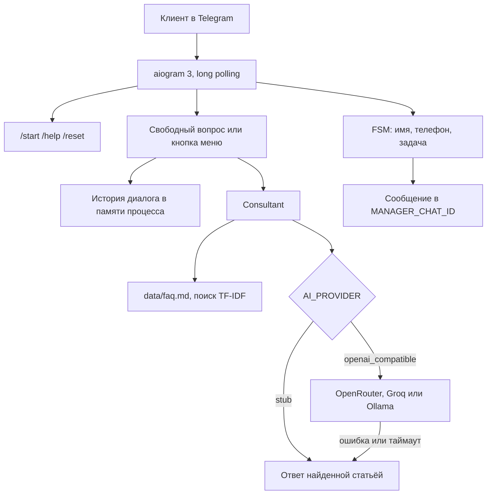
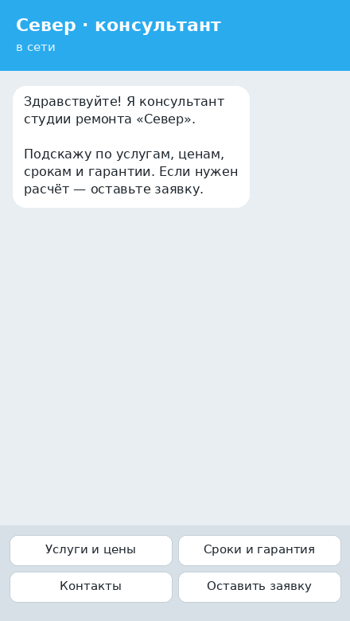
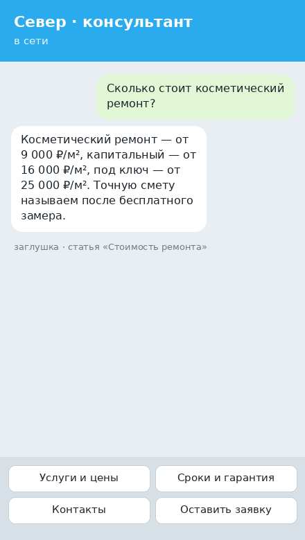
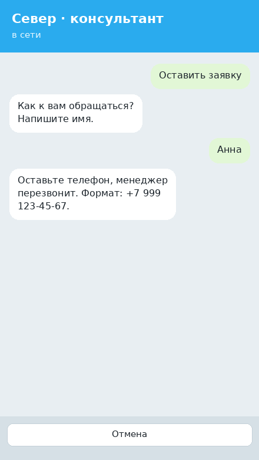

# Telegram-бот с AI-консультантом для бизнеса

[](https://github.com/karagodini/telegram-ai-bot-demo/actions/workflows/ci.yml)

Демо для портфолио: бот первой линии, который отвечает клиенту по базе знаний и собирает заявку менеджеру. В примере бот работает на студию ремонта «Север». Ключи от нейросетей не нужны: по умолчанию включена заглушка, она ищет ответ в `data/faq.md`.

Python 3.11+, [aiogram 3](https://docs.aiogram.dev/), long polling. Hugging Face не используется.

## Что умеет бот

- Отвечает на вопросы об услугах, ценах, сроках, гарантии и контактах.
- Держит короткий контекст диалога в памяти и забывает его по `/reset` или после перезапуска.
- Ведёт заявку по шагам: имя, телефон, задача. Кривой номер или пустое имя не пропускает.
- Пересылает готовую заявку в чат менеджера (`MANAGER_CHAT_ID`).
- Умеет два источника ответов. `stub` работает офлайн. `openai_compatible` ходит в любой API формата OpenAI и при сбое сам возвращается к заглушке, чтобы клиент не остался без ответа.

## Для кого

Один и тот же каркас закрывает первую линию там, где вопросы повторяются, а ночью менеджера нет:

- салон, клиника, автосервис — цены «от», адрес, запись;
- ремонт, клининг, монтаж — что входит в работу, сроки, выезд специалиста;
- студия или онлайн-школа — программа, стоимость, заявка на созвон;
- отдел продаж — бот не «продаёт вслепую», а отдаёт менеджеру уже собранный лид.

Чужой бизнес подключается сменой трёх файлов: факты в `data/faq.md`, роль в `prompts/system.txt`, приветствие в `bot/texts.py`.

## Архитектура



Заглушка сама ищет статью по последней реплике. Если реплика короткая («а сроки?»), к ней приклеивается предыдущий вопрос. Внешняя модель получает тот же поиск как выдержки в системном сообщении и не должна придумывать цены. История хранится в процессе: один инстанс polling, без базы. Так проще показать демо; для нескольких реплик бота историю выносят в Redis.

## Быстрый старт

Нужен токен от [@BotFather](https://t.me/BotFather). Менеджер, которому уходят заявки, сначала открывает бота и нажимает `/start`, иначе Telegram не даст написать ему первым. Его `chat_id` показывает команда `/chatid`.

### Локально

```bash
python3.11 -m venv .venv
source .venv/bin/activate
pip install -r requirements.txt
cp .env.example .env
```

В `.env` вставьте `BOT_TOKEN`. `AI_PROVIDER` оставьте `stub`, если ключа нет.

```bash
python -m bot
```

Проверить базу знаний без Telegram:

```bash
python -m bot.ask "Сколько стоит капитальный ремонт?"
```

Тесты и линтер:

```bash
pip install -r requirements-dev.txt
ruff check .
ruff format --check .
pytest
```

### Docker

```bash
cp .env.example .env
# отредактируйте BOT_TOKEN
docker compose up --build
```

Образ собирается из `Dockerfile` на Python 3.11. Бот запускается от отдельного пользователя, не от root.

## Как подключить бесплатный API или Ollama

Провайдер один: `AI_PROVIDER=openai_compatible`. Меняются только адрес, модель и ключ. Список моделей на бесплатных шлюзах меняется — перед запуском сверьтесь с каталогом, ссылки ниже.

Если шлюз ответил ошибкой, оборвался по таймауту или вернул пустой текст, бот пишет об этом в лог и отвечает заглушкой по FAQ. Клиент этого переключения не видит.

### OpenRouter

Бесплатные модели помечены `:free`. Роутер `openrouter/free` сам выбирает свободную модель. Ключ создаётся на [openrouter.ai/keys](https://openrouter.ai/keys), каталог — [openrouter.ai/models?max_price=0](https://openrouter.ai/models?max_price=0).

```env
AI_PROVIDER=openai_compatible
OPENAI_API_KEY=sk-or-...
OPENAI_BASE_URL=https://openrouter.ai/api/v1
OPENAI_MODEL=openrouter/free
```

Чтобы зафиксировать конкретную модель, подставьте её id, например модель с суффиксом `:free` из каталога.

### Groq

Базовый URL совместим с OpenAI. Ключ — в [консоли Groq](https://console.groq.com/keys), актуальные id — в [списке моделей](https://console.groq.com/docs/models).

```env
AI_PROVIDER=openai_compatible
OPENAI_API_KEY=gsk_...
OPENAI_BASE_URL=https://api.groq.com/openai/v1
OPENAI_MODEL=llama-3.3-70b-versatile
```

### Ollama на своей машине

```bash
ollama pull llama3.2
ollama serve
```

```env
AI_PROVIDER=openai_compatible
OPENAI_API_KEY=
OPENAI_BASE_URL=http://127.0.0.1:11434/v1
OPENAI_MODEL=llama3.2
```

Пустой ключ для адреса с `localhost`, `127.0.0.1` или `host.docker.internal` допустим: Ollama его не проверяет. Из Docker до Ollama на хосте используйте `http://host.docker.internal:11434/v1` — в `docker-compose.yml` этот хост уже прописан.

## Команды

| Команда | Действие |
| --- | --- |
| `/start` | приветствие и меню, контекст очищается |
| `/help` | что бот умеет |
| `/reset` | стереть историю диалога и выйти из заявки |
| `/lead` | начать заявку |
| `/cancel` | отменить заявку |
| `/chatid` | показать id чата для `MANAGER_CHAT_ID` |

Кнопка «Оставить заявку» запускает тот же сценарий. «Отмена» на клавиатуре прерывает его.

## Структура проекта

```
bot/
  app.py                  запуск polling
  ask.py                  разовый вопрос к заглушке без Telegram
  config.py               pydantic-settings
  memory.py               история диалога
  texts.py                тексты для клиента
  handlers/               команды, диалог, заявка
  knowledge/faq.py        разбор Markdown и TF-IDF
  providers/              stub, OpenAI-совместимый клиент, фолбэк
  services/               консультант и проверка полей заявки
data/faq.md               база знаний примера
prompts/system.txt        системный промпт
tests/                    pytest
.github/workflows/ci.yml  ruff и pytest на Python 3.11 и 3.12
```

Секция FAQ — это заголовок `##`. Строка `keywords:` в ответ клиенту не попадает, она только помогает поиску. Поиск режет слова на токены, слегка снимает русские окончания и сравнивает векторы TF-IDF. Этого хватает для короткой базы; формулировки, которые стеммер не угадывает, дописываются в `keywords`.

## Скриншоты

Ниже схемы экранов, собранные для репозитория. Перед кейсом на Kwork их лучше заменить живыми снимками из Telegram.

| Старт | Диалог | Заявка |
| --- | --- | --- |
|  |  |  |

## Заказать такого бота

Нужен такой же консультант под ваш бизнес: своя база, тон общения, заявка менеджеру и при желании CRM.

[Заказать на Kwork](https://kwork.ru/user/karagodini)

## Лицензия

[MIT](LICENSE).
